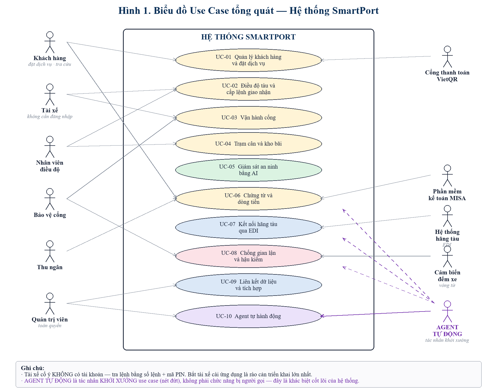
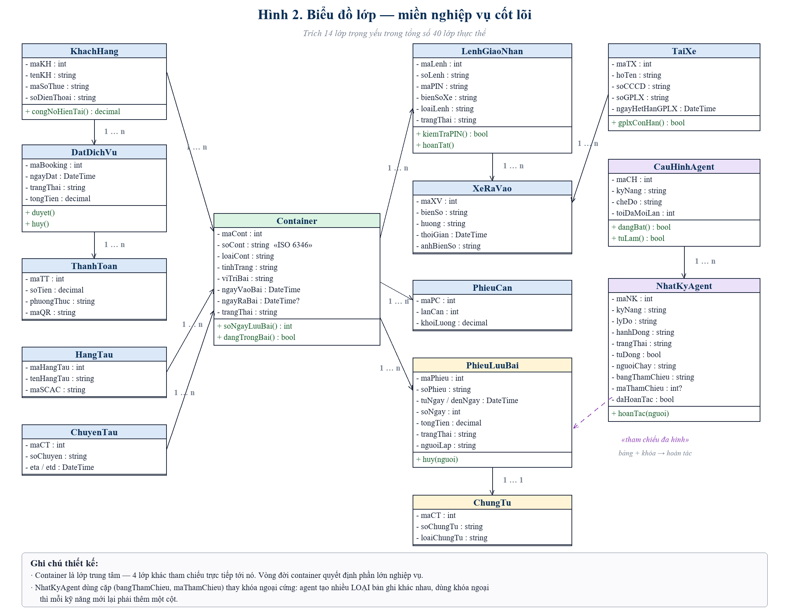
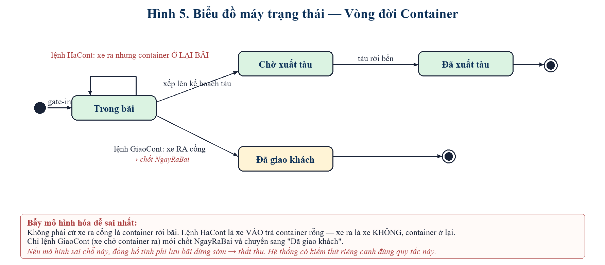
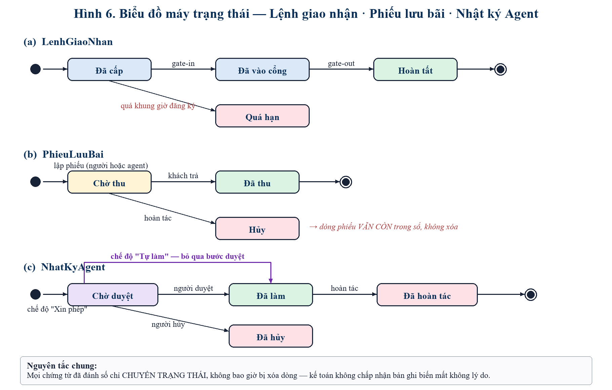
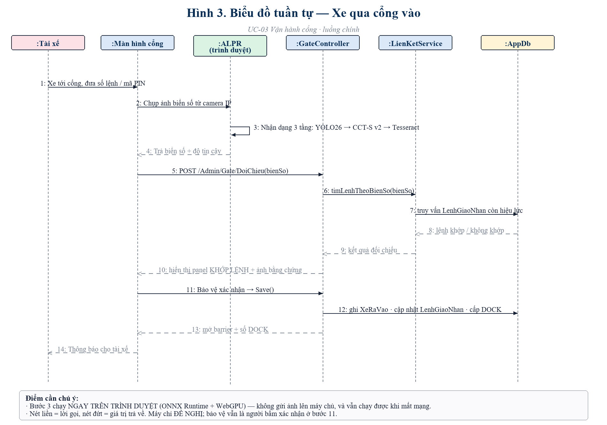
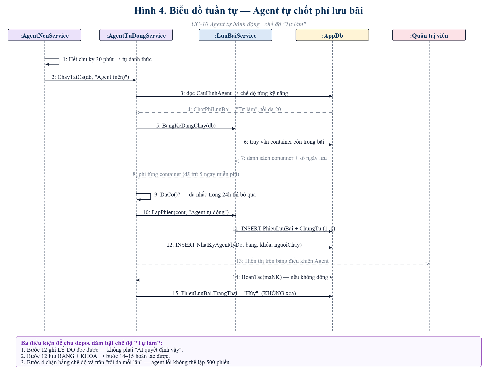

# PHÂN TÍCH VÀ THIẾT KẾ HƯỚNG ĐỐI TƯỢNG
## Hệ thống Quản lý và Điều hành Cảng biển Thông minh — SmartPort

**Sinh viên:** Lê Hữu Anh Tài · **MSSV:** 2424802010066
**Trường Đại học Thủ Dầu Một** · Ngày lập: 08/09/2026

> Tài liệu này được rút ra từ **mã nguồn đang chạy**, không phải mô hình giả định.
> Mọi con số (40 lớp thực thể, 99 chức năng, 3 vai trò, các giá trị trạng thái)
> đều lấy trực tiếp từ `SmartPort.Net10` và cơ sở dữ liệu `SmartPortDB`.

---

# 1. MÔ TẢ HỆ THỐNG

## 1.1. Bối cảnh bài toán

Depot và ICD (cảng cạn) ở Việt Nam hiện vận hành theo một mô thức chung: **dữ liệu bị cắt rời thành từng ốc đảo**.

- Bảo vệ ghi sổ tay lượt xe ra vào.
- Trạm cân in phiếu giấy, kẹp vào tập hồ sơ.
- Kế toán mở Excel riêng để tính phí lưu bãi.
- Hãng tàu đòi báo cáo qua email, gõ tay từng dòng.

Hệ quả đo được: khi khách hỏi *"container của tôi đang ở đâu, đang nợ bao nhiêu"*, không ai trả lời ngay được — phải lục ba nơi. Và tiền lưu bãi thì **treo ngoài bãi mà không ai biết là bao nhiêu**, vì con số chỉ hiện trên màn hình chứ không ai chốt được thành phiếu thu.

Các giải pháp ngoại (TOS thương mại) giải quyết được, nhưng giá và yêu cầu hạ tầng vượt xa khả năng của doanh nghiệp vừa và nhỏ.

## 1.2. Định vị sản phẩm

> **SmartPort là phần mềm điều hành depot/ICD cho doanh nghiệp vừa và nhỏ Việt Nam — chạy trên camera sẵn có, và AI không chỉ *nhìn* mà *tự làm việc*.**

Ba điểm tựa, mỗi điểm gắn với một nỗi đau ở trên:

| Điểm tựa | Giải quyết |
|---|---|
| **Liên kết dữ liệu toàn hệ thống** — một dòng thời gian duy nhất cho mỗi container | Dữ liệu ốc đảo |
| **Đồng hồ lưu bãi → phiếu thu có mã QR** | Tiền treo ngoài bãi |
| **Agent tự hành động** — tự lập phiếu, tự sinh bản tin EDI, có lý do và nút hoàn tác | Việc lặp đi lặp lại, làm tay dễ sót |

## 1.3. Đặc trưng kỹ thuật nổi bật

**AI suy luận ngay trên trình duyệt.** Mô hình YOLO26 (nhận diện), CCT-S v2 (đọc ký tự), MediaPipe (khung xương, khuôn mặt) chạy bằng ONNX Runtime + WebGPU **trong máy người dùng**. Hệ quả nghiệp vụ: không cần máy chủ GPU, không gửi hình ảnh ra ngoài, và **chạy được cả khi mất mạng** — điều kiện thường gặp ở chốt bảo vệ cổng cảng.

**Agent quyết định bằng luật, không bằng mô hình ngôn ngữ.** Đây là lựa chọn có chủ ý: agent đụng tới tiền của khách (lập phiếu thu) và báo cáo gửi hãng tàu, nên mỗi hành động phải giải thích được trước kiểm toán.

## 1.4. Nền tảng triển khai

| Thành phần | Công nghệ |
|---|---|
| Ứng dụng web | ASP.NET Core MVC, .NET 10 |
| Truy cập dữ liệu | Entity Framework Core 10 (Code-First, Data Annotations) |
| Cơ sở dữ liệu | Microsoft SQL Server |
| Giao diện | Razor View Engine + Bootstrap 5.3 |
| AI phía trình duyệt | ONNX Runtime Web (WebGPU), TensorFlow.js, MediaPipe, Tesseract.js |
| Ứng dụng di động | .NET MAUI (Android) |
| Kiểm thử | 325 kiểm thử tự động, khẳng định trên **số dòng và số tiền trong CSDL** |

---

# 2. PHẠM VI HỆ THỐNG

## 2.1. Phạm vi nghiệp vụ — mô hình *gate-to-gate*

Hệ thống bao trọn vòng đời một lượt giao nhận, từ lúc khách đặt dịch vụ đến lúc xe rời cổng, chia làm **12 giai đoạn**:

| GĐ | Giai đoạn | Vai trò chính |
|---|---|---|
| 1 | Khách đăng ký & đặt dịch vụ | Khách hàng |
| 2 | Thanh toán phí trước | Khách · Thu ngân |
| 3 | Tạo lệnh giao nhận điện tử (eGate Pass) | Điều độ |
| 4 | Điều độ tàu & phân bổ bến | Điều độ |
| 5 | Cổng vào — nhận dạng biển số, đối chiếu lệnh | Tự động |
| 6 | Trạm cân lần 1 (VGM) | Trạm cân |
| 7 | Hạ bãi — gợi ý vị trí | Bãi |
| 8 | Giám sát trong cảng | An ninh (tự động) |
| 9 | Hồ sơ container 360° | Điều độ · Giao nhận |
| 10 | Chứng từ — in & ghi sổ tự động | Giao nhận |
| 11 | Cổng ra — cân lần 2, khép vòng đời lệnh | Tự động |
| 12 | Hậu kiểm & điều hành | Quản trị |

## 2.2. Ranh giới hệ thống

### Nằm TRONG phạm vi

- Quản lý container, tàu, bến, chuyến tàu, hãng tàu, khách hàng
- Đặt dịch vụ trực tuyến và thanh toán (VietQR / NAPAS 247)
- Lệnh giao nhận điện tử có số lệnh + mã PIN
- Cổng thông minh: nhận dạng biển số, đối chiếu lệnh, điều phối dock
- Trạm cân điện tử hai lần, phiếu cân phục vụ khai VGM
- Sơ đồ bãi, gợi ý vị trí hạ bãi
- Giám sát AI: lửa, người ngã, đột nhập, giám sát tài xế
- Tính và **chốt** phí lưu bãi thành phiếu thu; theo dõi công nợ
- Thu phí tại cổng: thẻ tháng, thẻ trả trước, tiền mặt
- Trao đổi EDI với hãng tàu: CODECO, COPARN, COARRI (UN/EDIFACT D:95B)
- Đối soát chống gian lận đếm xe
- Quét CCCD gắn chip, OCR giấy phép lái xe
- Agent tự hành động với nhật ký và cơ chế hoàn tác
- API tích hợp mở `/api/v1/` cho hệ thống bên thứ ba

### Nằm NGOÀI phạm vi

| Không làm | Lý do |
|---|---|
| Kế toán tài chính đầy đủ, sổ cái, báo cáo thuế | Xuất dữ liệu sang **MISA**, không thay thế phần mềm kế toán |
| Điều khiển cẩu, thiết bị xếp dỡ thực địa | Thuộc hệ thống điều khiển công nghiệp riêng |
| Khai báo hải quan điện tử (VNACCS/VCIS) | Nghiệp vụ nhà nước, cần kết nối riêng |
| Quản lý nhân sự, chấm công, tiền lương | Ngoài trọng tâm điều hành cảng |
| Hoạch định tuyến vận tải đường bộ | Thuộc phần mềm TMS |

## 2.3. Ràng buộc và giả định

**Ràng buộc**

1. Phải chạy được trên **camera IP sẵn có** của depot — không bắt khách mua thiết bị mới.
2. AI phải chạy **phía trình duyệt** để không cần máy chủ GPU.
3. Bản tin EDI phải đúng chuẩn **UN/EDIFACT D:95B** thì hãng tàu mới nhận.
4. Mã container phải hợp lệ theo **ISO 6346** (có chữ số kiểm tra).
5. Mọi chứng từ đã đánh số **không được xóa** — chỉ chuyển trạng thái *Hủy*, giữ dấu vết cho kiểm toán.

**Giả định**

1. Có kết nối Internet cho thanh toán QR và gửi EDI; các chức năng còn lại chạy được khi mất mạng.
2. Người dùng tại cổng thao tác trên màn hình đơn giản, **không qua đào tạo dài**.
3. Mỗi container tại một thời điểm chỉ thuộc **một** lệnh giao nhận đang hiệu lực.

---

# 3. ĐỐI TƯỢNG

## 3.1. Đối tượng sử dụng (Actor)

### 3.1.1. Tác nhân là người

Hệ thống cài đặt **3 vai trò** phân quyền thực tế (`Admin`, `NhanVien`, `KhachHang`), trong đó `NhanVien` được chia tiếp theo vị trí công việc:

| Tác nhân | Vai trò kỹ thuật | Quan tâm điều gì |
|---|---|---|
| **Quản trị viên** | `Admin` | Cấu hình hệ thống, phân quyền, biểu phí, khóa API, chế độ Agent, nhật ký thanh tra |
| **Nhân viên điều độ** | `NhanVien` | Lệnh giao nhận, lịch tàu, phân bổ bến, vị trí hạ bãi |
| **Nhân viên giao nhận** | `NhanVien` | Hồ sơ container, chứng từ EIR, bản tin EDI, phiếu sửa chữa EOR |
| **Bảo vệ / nhân viên cổng** | `NhanVien` | Cổng vào–ra, đối chiếu lệnh, thu phí cổng, quét giấy tờ tài xế |
| **Nhân viên trạm cân** | `NhanVien` | Phiếu cân hai lần, số liệu VGM |
| **Thu ngân / kế toán** | `NhanVien` | Đối soát thanh toán, phiếu thu lưu bãi, công nợ, xuất MISA |
| **Khách hàng** | `KhachHang` | Đặt dịch vụ, thanh toán, tra cứu container, xem công nợ của mình |
| **Tài xế** | *không cần đăng nhập* | Tra lệnh bằng **mã PIN**, check-in trực tuyến |
| **Khách vãng lai** | *không cần đăng nhập* | Tra cứu container công khai, xem lịch tàu, tin tức, hỏi chatbot |

> **Ghi chú thiết kế:** tài xế **cố ý không có tài khoản**. Bắt tài xế cài ứng dụng và nhớ mật khẩu là rào cản thực tế lớn nhất khi triển khai; dùng số lệnh + PIN vừa đủ an toàn vừa không cản trở.

### 3.1.2. Tác nhân là hệ thống

| Tác nhân | Vai trò |
|---|---|
| **Camera IP** | Cấp luồng hình ảnh cho cổng và giám sát an ninh |
| **Cảm biến đếm xe** (vòng từ) | Gửi xung đếm độc lập qua API để đối soát chống gian lận |
| **Hệ thống hãng tàu** | Nhận CODECO/COARRI, gửi COPARN qua EDI |
| **Cổng thanh toán VietQR / NAPAS 247** | Sinh mã QR động, xác nhận giao dịch |
| **Phần mềm kế toán MISA** | Nhận dữ liệu xuất ra |
| **Ứng dụng bên thứ ba** | Gọi API `/api/v1/` bằng khóa có phân quyền |

### 3.1.3. Biểu đồ Use Case tổng quát



### 3.1.4. Tác nhân đặc biệt — **Agent tự động**

Đây là điểm khác biệt về mặt phân tích: **Agent là một tác nhân *khởi xướng* use case, không phải một chức năng bị người gọi.**

Agent tự đánh thức theo chu kỳ 30 phút, tự quyết định có hành động hay không, và **tự gọi các use case nghiệp vụ** của chính hệ thống. Nó có 3 chế độ do người đặt cho từng kỹ năng:

| Chế độ | Hành vi |
|---|---|
| **Tắt** | Kỹ năng im hoàn toàn |
| **Xin phép** | Chỉ tạo đề nghị, chờ người duyệt (mặc định) |
| **Tự làm** | Tự thực hiện, ghi nhật ký, người có thể hoàn tác |

## 3.2. Đối tượng nghiệp vụ (lớp thực thể)

Hệ thống có **40 lớp thực thể**, nhóm theo 8 gói chức năng:

### Gói 1 — Đối tác & Tài khoản
`KhachHang` · `TaiKhoan` · `HangTau` · `TaiXe` · `KhuonMat`

### Gói 2 — Tàu & Bến
`Tau` · `Ben` · `ChuyenTau`

### Gói 3 — Hàng hóa & Bãi
`Container` · `NhietDoLog` · `PhieuSuaChua` · `KiemDem`

### Gói 4 — Dịch vụ & Dòng tiền
`DichVu` · `DatDichVu` · `DatDichVuChiTiet` · `ThanhToan` · `PhieuLuuBai` · `ChungTu` · `SanLuongThang`

### Gói 5 — Cổng & Vận hành
`LenhGiaoNhan` · `XeRaVao` · `PhieuCan` · `BieuPhiCong` · `TheXe` · `DemXeCong` · `XungDemXe`

### Gói 6 — Trí tuệ nhân tạo & An ninh
`NhanDienAI` · `NhanDienChiTiet` · `SuCoAnNinh` · `CameraIP` · `MediaAI` · `PhanHoiAI`

### Gói 7 — Agent tự động
`CauHinhAgent` · `NhatKyAgent`

### Gói 8 — Tích hợp & Hệ thống
`BanTinEDI` · `ApiKey` · `NhatKy` · `TinTuc` · `LienHe` · `CauHinhAnh`

### 3.2.1. Biểu đồ lớp — miền nghiệp vụ cốt lõi



### 3.2.2. Lớp trung tâm — `Container`

`Container` là lớp có nhiều liên kết nhất, đóng vai trò **trục xoay của toàn hệ thống**. Bốn lớp khác tham chiếu trực tiếp tới nó (`MaCont`): `LenhGiaoNhan`, `PhieuLuuBai`, `PhieuSuaChua`, `NhietDoLog`.

**Vòng đời trạng thái** (giá trị thực trong CSDL):

```
Trong bãi ──▶ Chờ xuất tàu ──▶ Đã xuất tàu
    │
    └──────▶ Đã giao khách
```

Quy tắc nghiệp vụ đi kèm: chỉ lệnh loại **GiaoCont** (xe chở container ra) mới chốt `NgayRaBai` và chuyển sang *Đã giao khách*. Lệnh **HaCont** (xe vào trả container rỗng) thì xe ra nhưng container **vẫn ở lại bãi** — đây là chỗ dễ sai nhất khi mô hình hóa, và đã có kiểm thử riêng canh.



### 3.2.3. Các vòng đời trạng thái khác

| Lớp | Các trạng thái thực tế |
|---|---|
| `LenhGiaoNhan` | Đã vào cổng → Hoàn tất · (Quá hạn) |
| `DatDichVu` | Chờ duyệt → Đã duyệt → Đang thực hiện → Hoàn thành · (Đã hủy) |
| `PhieuLuuBai` | Chờ thu → Đã thu · (Hủy) |
| `NhatKyAgent` | Chờ duyệt → Đã làm · (Đã hủy) · cờ *Đã hoàn tác* |



### 3.2.4. Quan hệ trọng yếu

| Quan hệ | Bản số | Ý nghĩa |
|---|---|---|
| `KhachHang` — `DatDichVu` | 1 — n | Một khách đặt nhiều đơn dịch vụ |
| `DatDichVu` — `DatDichVuChiTiet` | 1 — n | Đơn gồm nhiều dòng dịch vụ |
| `DatDichVu` — `ThanhToan` | 1 — n | Một đơn có thể trả nhiều lần |
| `HangTau` — `Container` | 1 — n | Container thuộc về một hãng tàu |
| `ChuyenTau` — `Container` | 1 — n | Container đi theo một chuyến |
| `Container` — `LenhGiaoNhan` | 1 — n | Nhiều lượt giao nhận trên cùng container |
| `LenhGiaoNhan` — `XeRaVao` | 1 — n | Một lệnh sinh lượt vào và lượt ra |
| `Container` — `PhieuLuuBai` | 1 — n | Nhiều kỳ chốt phí |
| `PhieuLuuBai` — `ChungTu` | 1 — 1 | Mỗi phiếu sinh đúng một chứng từ số |
| `NhatKyAgent` — *(bảng, khóa)* | tham chiếu đa hình | Trỏ tới bản ghi agent đã tạo, phục vụ hoàn tác |

> **Ghi chú thiết kế:** `NhatKyAgent` dùng cặp `BangThamChieu` + `MaThamChieu` (tham chiếu đa hình) thay vì khóa ngoại cứng. Lý do: agent tạo ra nhiều loại bản ghi khác nhau (phiếu lưu bãi, bản tin EDI, sự cố an ninh); nếu dùng khóa ngoại thì mỗi kỹ năng mới lại phải thêm một cột.

---

# 4. CHỨC NĂNG

Hệ thống có **99 chức năng** được đánh số liên tục, phân thành 14 nhóm. Bảng đầy đủ xem tại màn hình `/Admin/Dashboard/QuyTrinh`.

## 4.1. Tổng hợp theo nhóm

| Nhóm chức năng | Số CN |
|---|---:|
| GĐ 1–2 · Khách hàng & thanh toán | 13 |
| GĐ 5–6 · Cổng vào & trạm cân | 11 |
| **Agent tự hành động** | 10 |
| GĐ 8 · Giám sát AI 24/7 | 9 |
| Dòng tiền | 8 |
| Nền tảng hệ thống | 7 |
| GĐ 9–10 · Hồ sơ & chứng từ | 7 |
| An ninh · chống gian lận | 7 |
| Liên kết dữ liệu | 6 |
| GĐ 3–4 · Lệnh & điều độ tàu | 6 |
| GĐ 11–12 · Ra cổng & hậu kiểm | 6 |
| GĐ 7 · Kho bãi | 5 |
| Kết nối hãng tàu · EDI | 4 |
| **Tổng cộng** | **99** |

## 4.2. Nhóm use case chính

### UC-01 · Quản lý khách hàng và đặt dịch vụ
Đăng ký tài khoản · đăng nhập bằng mật khẩu hoặc **khuôn mặt** · đặt dịch vụ trực tuyến · thanh toán VietQR · nhận hóa đơn qua email · tra cứu container · ước tính chi phí bằng AI · hỏi chatbot.

### UC-02 · Điều độ tàu và cấp lệnh giao nhận
Quản lý lịch tàu (ETA/ETD/ATA/ATD) · AI chấm điểm phân bổ bến theo chiều dài, mớn nước, lịch trống · tạo lệnh giao nhận điện tử kèm **số lệnh + mã PIN** · cổng tra cứu cho tài xế.

### UC-03 · Vận hành cổng
Nhận dạng biển số ba tầng AI · **tự đối chiếu lệnh** theo biển số · soi ngoại quan phát hiện móp méo · điều phối dock · lưu ảnh làm bằng chứng · thu phí cổng (thẻ tháng → thẻ trả trước → tiền mặt) · quét CCCD gắn chip · OCR giấy phép lái xe kèm cảnh báo hết hạn.

### UC-04 · Trạm cân và kho bãi
Cân hai lần, xuất phiếu phục vụ khai VGM theo công ước SOLAS · AI gợi ý vị trí hạ bãi (block–bay–row–tier) · sơ đồ bãi trực quan · giám sát nhiệt độ container lạnh.

### UC-05 · Giám sát an ninh bằng AI
Nhận diện vật thể · phát hiện lửa, người ngã, đột nhập, vật tĩnh bất thường · giám sát tài xế (ngủ gật, ngáp, dùng điện thoại) · AI tự học trạng thái lạ qua phản hồi · kiểm đếm hàng theo đơn.

### UC-06 · Chứng từ và dòng tiền
Sinh EIR song ngữ · kho chứng từ số · **đồng hồ lưu bãi** tính phí theo thời gian thực · chốt kỳ thành phiếu thu có mã QR · bảng kê công nợ · đối soát thanh toán · xuất dữ liệu sang MISA.

### UC-07 · Kết nối hãng tàu qua EDI
Sinh **CODECO** báo container vào/ra bãi · đọc **COPARN** để tự lập lệnh cấp rỗng · sinh **COARRI** báo cáo dỡ/xếp theo chuyến tàu · quản lý bản tin đã gửi/chưa gửi.

### UC-08 · Chống gian lận và hậu kiểm
Nhận xung từ cảm biến đếm xe độc lập (**chống gửi trùng** bằng mã xung thiết bị) · đối soát số đếm máy với số khai báo · lệch quá ngưỡng thì tự mở sự cố và buộc giải trình · ước tính tiền thất thoát · nhật ký thanh tra toàn hệ thống.

### UC-09 · Liên kết dữ liệu và tích hợp
Hồ sơ container 360° gộp 7 nguồn dữ liệu trên **một dòng thời gian** · hồ sơ xe · tìm kiếm toàn cục (Ctrl+K) · API mở `/api/v1/` với khóa phân quyền theo khách hàng · tài liệu API in được.

### UC-10 · Agent tự hành động *(nhóm mới, 10 chức năng)*

| Kỹ năng | Hành động **thật** agent thực hiện |
|---|---|
| Chốt phí lưu bãi | **Lập phiếu thu** có số, có mã QR |
| Sinh CODECO | **Tạo bản tin EDI** gửi hãng tàu |
| Nhắc nợ quá hạn | Dựng danh sách phiếu quá hạn kèm số tiền |
| Cảnh báo thẻ xe | Bắt thẻ sắp/đã hết hạn trước khi xe tới cổng |
| Giục duyệt EOR | Không để phiếu sửa chữa nằm chết trong hàng đợi |
| Cảnh báo tồn lâu | Chỉ ra vốn đang chết ngoài bãi |
| Chặn bằng lái hết hạn | **Tự mở sự cố an ninh** |

Kèm theo: bảng điều khiển 3 chế độ · nhật ký ghi **lý do đọc được** + người khởi chạy · hoàn tác từng việc · bộ chạy nền 30 phút và API `/api/v1/agent/chay` cho bộ hẹn giờ ngoài.

## 4.3. Đặc tả use case chi tiết

### UC-03.2 — Xe qua cổng vào

| Mục | Nội dung |
|---|---|
| **Mã** | UC-03.2 |
| **Tên** | Xe qua cổng vào (gate-in) |
| **Tác nhân chính** | Bảo vệ cổng |
| **Tác nhân phụ** | Tài xế · Camera IP |
| **Mô tả** | Xe tải chở container tới cổng. Hệ thống đọc biển số, tự đối chiếu lệnh giao nhận đã đăng ký trước, cấp số dock và mở barrier. |
| **Tiền điều kiện** | Lệnh giao nhận đã được cấp, còn hiệu lực, chưa hoàn tất. Camera cổng đang hoạt động. |
| **Hậu điều kiện** | Có một bản ghi `XeRaVao` hướng "Vào" · `LenhGiaoNhan.TrangThai` = "Đã vào cổng" · ảnh biển số được lưu làm bằng chứng. |

**Luồng chính**

1. Tài xế đưa xe vào làn, xuất trình số lệnh hoặc mã PIN.
2. Hệ thống chụp ảnh từ camera IP.
3. Mô hình AI nhận dạng biển số theo ba tầng: YOLO26 khoanh vùng → CCT-S v2 đọc ký tự → Tesseract đối chiếu.
4. Hệ thống tìm lệnh giao nhận còn hiệu lực khớp biển số.
5. Màn hình hiện panel **KHỚP LỆNH**: thông tin lệnh, container, tài xế, kèm ảnh bằng chứng.
6. Bảo vệ đối chiếu bằng mắt rồi bấm **Xác nhận**.
7. Hệ thống ghi `XeRaVao`, cập nhật trạng thái lệnh, cấp số dock, mở barrier.

**Luồng thay thế**

| Mã | Tình huống | Xử lý |
|---|---|---|
| 4a | Không tìm thấy lệnh khớp biển số | Cảnh báo đỏ. Bảo vệ nhập tay số lệnh để tra lại, hoặc từ chối cho vào. |
| 3a | Độ tin cậy nhận dạng dưới ngưỡng | Hiện biển số dự đoán ở dạng có thể sửa; bảo vệ gõ lại. |
| 6a | Giấy phép lái xe của tài xế đã hết hạn | Hệ thống chặn và tự mở sự cố an ninh (liên kết UC-08). |
| 2a | Mất kết nối Internet | Nhận dạng vẫn chạy được vì AI nằm trên trình duyệt; dữ liệu ghi vào hàng đợi, đồng bộ khi có mạng. |

---

### UC-06.3 — Chốt phí lưu bãi thành phiếu thu

| Mục | Nội dung |
|---|---|
| **Mã** | UC-06.3 |
| **Tên** | Chốt phí lưu bãi thành phiếu thu |
| **Tác nhân chính** | Thu ngân · **hoặc Agent tự động** |
| **Mô tả** | Chuyển con số phí đang chạy trên màn hình thành một phiếu thu có số, có mã QR để đi đòi tiền. |
| **Tiền điều kiện** | Container đã ở bãi quá số ngày miễn phí (mặc định 5 ngày). Chưa có phiếu còn hiệu lực cho kỳ này. |
| **Hậu điều kiện** | Có một `PhieuLuuBai` trạng thái "Chờ thu" · kèm đúng **một** `ChungTu` được đánh số · mã QR VietQR sinh theo đúng số tiền. |

**Luồng chính**

1. Thu ngân mở bảng kê công nợ đang chạy.
2. Hệ thống gọi `LuuBaiService` tính phí cho từng container: ngày bắt đầu là `NgayVaoBai`, ngày kết thúc là `NgayRaBai` hoặc thời điểm hiện tại nếu đồng hồ còn chạy.
3. Thu ngân chọn container cần chốt, bấm **Lập phiếu**.
4. Hệ thống sinh số phiếu theo mẫu `PLB-yyMM-####`.
5. Hệ thống ghi `PhieuLuuBai` và `ChungTu` trong cùng một giao dịch.
6. Sinh mã QR VietQR theo đúng số tiền, in phiếu song ngữ.

**Luồng thay thế**

| Mã | Tình huống | Xử lý |
|---|---|---|
| 4a | Số phiếu vừa sinh đã tồn tại | Hàm sinh số tra **cả hai** bảng `PhieuLuuBai` và `ChungTu` rồi lấy số lớn hơn — vì phiếu có thể bị hủy nhưng chứng từ thì không bao giờ xóa. |
| 2a | Container là loại lạnh (reefer) | Tiền điện tính **từ ngày đầu tiên**, không có ngày miễn phí. |
| 3a | Agent chạy thay người ở chế độ "Tự làm" | Cùng luồng, nhưng `NguoiLap` = "Agent tự động" và ghi thêm một dòng `NhatKyAgent` có lý do, để hoàn tác được (xem UC-10.1). |

---

### UC-10.1 — Agent tự chốt phí lưu bãi

| Mục | Nội dung |
|---|---|
| **Mã** | UC-10.1 |
| **Tên** | Agent tự chốt phí lưu bãi |
| **Tác nhân chính** | **Agent tự động** (tác nhân khởi xướng) |
| **Tác nhân phụ** | Quản trị viên (duyệt hoặc hoàn tác) |
| **Mô tả** | Agent tự đánh thức theo chu kỳ, tự phát hiện container quá hạn miễn phí và **tự lập phiếu thu** — không phải chỉ đề xuất. |
| **Tiền điều kiện** | Kỹ năng `ChotPhiLuuBai` đang ở chế độ "Xin phép" hoặc "Tự làm". |
| **Hậu điều kiện** | Mỗi việc agent làm đều có một dòng `NhatKyAgent` ghi **lý do đọc được**, **người khởi chạy**, và **bảng + khóa** của bản ghi đã tạo để hoàn tác. |

**Luồng chính**

1. Bộ chạy nền đánh thức agent sau mỗi 30 phút.
2. Agent đọc `CauHinhAgent` để biết chế độ và trần `ToiDaMoiLan` của từng kỹ năng.
3. Agent lấy danh sách container còn trong bãi kèm số ngày lưu.
4. Với mỗi container quá ngưỡng, agent kiểm tra `DaCo()` — đã nhắc trong 24 giờ qua thì bỏ qua, tránh nhắc lại phiền.
5. **Nếu chế độ "Tự làm":** agent gọi thẳng `LuuBaiService.LapPhieu()` — tạo phiếu thật.
6. **Nếu chế độ "Xin phép":** agent chỉ ghi nhật ký trạng thái "Chờ duyệt", chưa tạo gì.
7. Agent ghi `NhatKyAgent` với lý do, hành động, bảng và khóa tham chiếu.
8. Quản trị viên xem trên bảng điều khiển Agent.

**Luồng thay thế**

| Mã | Tình huống | Xử lý |
|---|---|---|
| 2a | Chế độ "Tắt" | Kỹ năng không chạy, không sinh bản ghi nào. |
| 5a | Số bản ghi đạt trần `ToiDaMoiLan` | Dừng kỹ năng ở lượt này — agent lỗi không thể tạo hàng trăm phiếu. |
| 8a | Quản trị viên duyệt việc "Chờ duyệt" | Lúc đó mới lập phiếu, ghi lại người duyệt. |
| 8b | Quản trị viên **hoàn tác** | Đọc bảng + khóa trong nhật ký → chuyển `PhieuLuuBai.TrangThai` = "Hủy" (**không xóa dòng**), đánh dấu `DaHoanTac`. |
| \* | Một kỹ năng ném lỗi | Ghi nhật ký lỗi, **các kỹ năng còn lại vẫn chạy tiếp** — một kỹ năng hỏng không được làm chết cả agent. |

## 4.4. Yêu cầu phi chức năng

| Loại | Yêu cầu |
|---|---|
| **Hiệu năng** | AI suy luận trên trình duyệt, không phụ thuộc máy chủ GPU |
| **Khả dụng** | Chức năng cổng hoạt động được khi mất kết nối Internet |
| **Bảo mật** | Mật khẩu băm PBKDF2 · phân quyền theo vai trò · khóa API giới hạn theo khách hàng và quyền đọc/ghi · chống giả mạo biểu mẫu (anti-forgery) |
| **Kiểm toán** | Mọi thao tác ghi nhật ký người thực hiện · chứng từ đã đánh số không xóa, chỉ hủy |
| **Khả dụng (UX)** | Màn hình bảo vệ chỉ 2 nút · tìm kiếm toàn cục Ctrl+K · không cần đào tạo dài |
| **Tích hợp** | Chuẩn UN/EDIFACT D:95B · ISO 6346 · VietQR/NAPAS 247 · REST API JSON |
| **Chất lượng** | 325 kiểm thử tự động khẳng định trên **số dòng và số tiền trong CSDL**, không khẳng định trên chuỗi hiển thị |

---

# 5. THIẾT KẾ TƯƠNG TÁC

Hai biểu đồ tuần tự dưới đây mô tả hai luồng đại diện cho hai kiểu vận hành khác nhau của hệ thống: một luồng do **người** khởi xướng, một luồng do **máy** khởi xướng.

## 5.1. Luồng do người khởi xướng — Xe qua cổng



Điểm đáng chú ý ở bước 3: mô hình AI chạy **ngay trên trình duyệt** của máy trạm cổng, không gửi ảnh về máy chủ. Đây là lý do hệ thống không cần máy chủ GPU và vẫn hoạt động khi mất kết nối Internet — điều kiện thường gặp ở chốt bảo vệ.

Và ở bước 11: máy chỉ **đề nghị**, bảo vệ vẫn là người bấm xác nhận. Hệ thống không tự mở barrier chỉ vì AI nói biển số khớp.

## 5.2. Luồng do máy khởi xướng — Agent tự chốt phí lưu bãi



Đây là luồng thể hiện rõ nhất khác biệt của hệ thống: **không có tác nhân người nào ở đầu luồng**. Agent tự đánh thức (bước 1), tự quyết định (bước 4), tự tạo chứng từ dùng tiền thật (bước 10–11).

Chính vì thế thiết kế phải trả lời được ba câu hỏi mà hệ thống thông thường không cần trả lời — xem khung ghi chú trong hình.

---

# 6. KIẾN TRÚC PHÂN TẦNG

```
┌─────────────────────────────────────────────────────────┐
│  TẦNG GIAO DIỆN — Razor Views + Bootstrap 5             │
│  Khu vực Admin (34 controller) · Khu vực công khai (16) │
└────────────────────────┬────────────────────────────────┘
                         │
┌────────────────────────▼────────────────────────────────┐
│  TẦNG ĐIỀU KHIỂN — Controller                           │
│  Nhận yêu cầu · kiểm tra quyền · gọi dịch vụ · trả View │
└────────────────────────┬────────────────────────────────┘
                         │
┌────────────────────────▼────────────────────────────────┐
│  TẦNG NGHIỆP VỤ — 20 lớp dịch vụ (AppServices)          │
│  LuuBaiService · EdiService · PhiCongService            │
│  AgentTuDongService · LienKetService · YardService ...  │
└────────────────────────┬────────────────────────────────┘
                         │
┌────────────────────────▼────────────────────────────────┐
│  TẦNG TRUY CẬP DỮ LIỆU — AppDb (EF Core DbContext)      │
│  40 DbSet ánh xạ 40 lớp thực thể                        │
└────────────────────────┬────────────────────────────────┘
                         │
┌────────────────────────▼────────────────────────────────┐
│  CƠ SỞ DỮ LIỆU — Microsoft SQL Server                   │
└─────────────────────────────────────────────────────────┘
```

## 6.1. Nguyên tắc thiết kế đã áp dụng

**Một nguồn sự thật cho mỗi khái niệm nghiệp vụ.** Ví dụ: mọi phép tính phí lưu bãi đều đi qua `LuuBaiService` — màn hình hồ sơ container, bảng kê công nợ, và agent tự chốt đều gọi cùng một hàm. Nếu tính ở ba nơi thì sớm muộn ba nơi ra ba số khác nhau, và không ai biết số nào đúng.

**Tầng dịch vụ không biết gì về HTTP.** `LuuBaiService`, `EdiService`, `AgentTuDongService` chỉ nhận `AppDb` và tham số thuần. Nhờ vậy agent chạy nền gọi được đúng logic mà người bấm nút vẫn dùng — không phải viết lại lần hai.

**Nhật ký là một phần của thiết kế, không phải thứ thêm sau.** `NhatKyAgent` lưu *lý do* dưới dạng câu người đọc được, cùng bảng và khóa của bản ghi đã tạo. Không có nó thì khi khách khiếu nại *"sao tự nhiên có phiếu này"*, hệ thống không trả lời được.

---

# 7. KẾT LUẬN

SmartPort được phân tích theo hướng đối tượng với **40 lớp thực thể** chia thành **8 gói**, phục vụ **9 nhóm tác nhân người** cùng **6 hệ thống ngoài** và **1 tác nhân tự động**, cài đặt **99 chức năng** trên kiến trúc 5 tầng.

Điểm khác biệt về mặt phân tích thiết kế nằm ở chỗ **Agent được mô hình hóa như một tác nhân khởi xướng use case** chứ không phải một chức năng thụ động. Đây là điều buộc thiết kế phải trả lời ba câu hỏi mà hệ thống thông thường không cần trả lời:

1. Agent **được phép** làm gì? → mô hình 3 chế độ cho từng kỹ năng
2. Agent **đã làm gì** và **vì sao**? → nhật ký có lý do đọc được
3. Agent làm sai thì **gỡ thế nào**? → tham chiếu đa hình phục vụ hoàn tác

Thiếu bất kỳ câu nào trong ba câu đó, không chủ doanh nghiệp nào dám cho phần mềm tự động đụng vào tiền của khách hàng mình.
